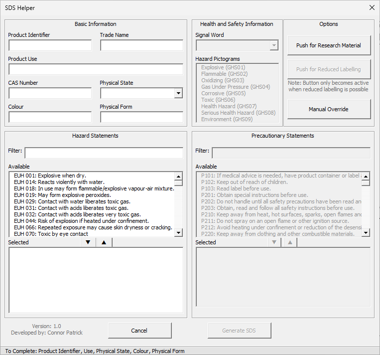

# SDS Helper

A macro-enabled Microsoft Word template that streamlines the writing of Material Safety Data Sheets (SDSs). Enter the key details once in a single form, click **Generate SDS**, and get an editable Word document that is pre-populated with your information and contains review comments to guide you through the final checks.

  

**Current version:** 1.0

## Highlights

- **One interface for most of the SDS:** Product details, hazard statements and options are all entered in a single form.
- **Hazard logic built in:** Selecting H phrases automatically assigns the associated P phrases, the highest-severity signal word and the appropriate pictograms, using logic taken from ECHA guidance.
- **Built-in checks:** A minimum-information check, CAS number validation, and a warning when a hazard statement doesn't match the selected physical state.
- **Reduced labelling and research materials** are each handled with a single button.
- **Editable output with review comments:** The generated Word document is fully editable, with comments pointing to the parts that need checking. The aim is to resolve them all before the SDS goes for approval.
- **Easy to maintain:** Hazard and precautionary phrases are read from an Excel spreadsheet, so wording can be updated without touching the macro.

See [Features](docs/features.md) for the full detail.

## Quick start

1. **Download** the latest version from the [Releases](../../releases) page.
2. **Unblock the file** so Word will run its macros. Files downloaded from the internet are blocked by default. See [Installation](docs/installation.md#2-unblock-the-file) for further information.
3. **Open** the file like any other Word document. There is a short delay while it loads, then the form appears.
4. **Complete sections 1 and 2** (Basic Information and Hazard Statements). The other sections fill themselves in.
5. Click **Generate SDS**, then work through the comments in the generated document before sending it for approval.

A step-by-step walkthrough is in the [User Guide](docs/user-guide.md).

## Requirements

- Microsoft Word (desktop application) with macros enabled. Word for the web cannot run macros.
- Access to the `assets` and `docs` folders, and files within. See [Installation](docs/installation.md#4-set-up-the-phrase-library).

> **Compatibility:** Microsoft Word (Microsoft 365) on Windows 10 and Windows 11. Other versions and operating systems may work, but have not been tested.

## Documentation

| Document | What's in it? |
| --- | --- |
| [Installation](docs/installation.md) | Downloading, unblocking and enabling macros, setting up the phrase library, troubleshooting |
| [User Guide](docs/user-guide.md) | Step-by-step instructions for completing the form and reviewing the output |
| [Features](docs/features.md) | What the tool does, including data validation and the hazard-phrase logic |

## Important notice

This tool produces a **draft** SDS to help authors work faster and more consistently. It does not replace professional judgement or your organisation's approval process. The author and approver remain responsible for the accuracy and regulatory compliance of every SDS issued.

The assignment logic follows [ECHA guidance](https://echa.europa.eu/support/guidance) (*Guidance on labelling and packaging in accordance with Regulation (EC) No 1272/2008*). Always check the output against the regulations that apply to you, as guidance and phrasing can change.

## Support and feedback

Found a bug, or have an idea for an improvement? Please [open an issue](../../issues) and include what you were doing, what you expected to happen, and what happened instead.

## Licence

