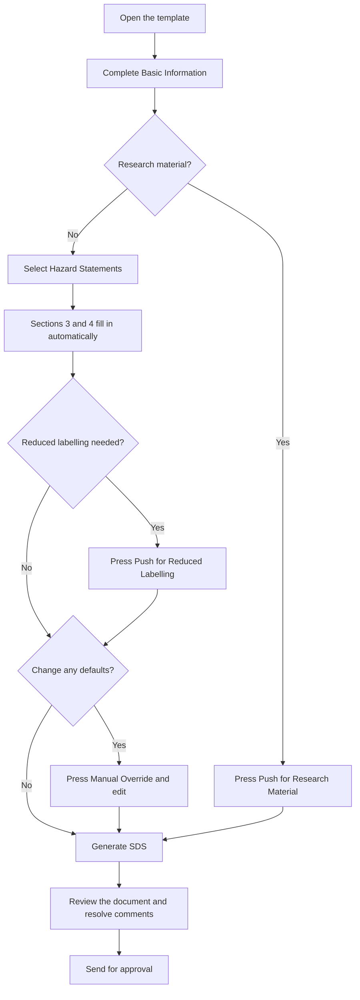

# User Guide

A step-by-step guide to completing an SDS with the SDS Helper. If you haven't set the tool up yet, start with [Installation](installation.md).

**Contents**

- [Project files overview](#project-files-overview)
- [Workflow at a glance](#workflow-at-a-glance)
- [The interface](#the-interface)
- [Completing the form](#completing-the-form)
- [Generating the SDS](#generating-the-sds)
- [After the SDS has been generated](#after-the-sds-has-been-generated)
- [Frequently asked questions](#frequently-asked-questions)
- [Further information](#further-information)

---

## Project files overview

This project is organised into a small number of files and folders that support the main SDS template and the documentation around it:

```text
AutoSDS/
├── README.md               # Project overview, quick-start guidance and links to docs
├── Template-SDS.dotm       # Main macro-enabled Word template used to complete and generate an SDS
├── assets/
│   └── pictograms/         # Pictogram images used in the template and generated output
├── data/
│   └── SDS Phrases.xlsx    # Phrase library used to populate hazard, precautionary and label information
├── docs/
│   ├── installation.md     # Setup, macros, troubleshooting and phrase-library instructions
│   ├── user-guide.md       # Step-by-step workflow for completing and reviewing the SDS
│   ├── features.md         # Validation rules and logic behind the automatic assignments
│   └── images/
│       └── interface.png   # Screenshot of the SDS Helper form
└── .github/                # Repository configuration and project metadata (if present)
```

The main file you need is `Template-SDS.dotm`. The rest of the files support application and provide documentation.

---

## Workflow at a glance



## The interface

Once the template has loaded, a form opens to help you complete the SDS. It is split into five sections:


| # | Section | Required? |
| --- | --- | --- |
| 1 | **Basic Information** | Yes |
| 2 | **Hazard Statements** | Yes (enter if known) |
| 3 | **Health and Safety Information** (signal word and pictograms) | No. Locked and filled in automatically |
| 4 | **Precautionary Statements** | No. Locked and filled in automatically |
| 5 | **Options** | Only when needed |

By default you only need to complete sections **1** and **2**. The relevant options in sections **3** and **4** are locked and populated for you.

The **status bar** at the bottom of the form lists what is still needed before you can generate the SDS.

## Completing the form

### 1. Basic Information

| Field | What to enter | Required? |
| --- | --- | --- |
| **Product Identifier** | A name used to identify the material. For hazardous materials, use the IUPAC name. | Yes |
| **Trade Name** | An alternative name used to identify the material (e.g. a company's external name). | No |
| **Product Use** | A simple and clear description of what the material is used for. | Yes |
| **CAS Number** | The CAS number, if known. It is checked for validity. If unknown, leave it blank and the SDS will show *"No data"*. | No (but must be valid if entered) |
| **Physical State** | Select the state of the material from the drop-down, e.g. *Solid* or *Liquid*. | Yes |
| **Colour** | The colour of the material. | Yes |
| **Physical Form** | Describe the appearance of the particles if a solid, including the degree of granularity. | Yes |

### 2. Hazard Statements

Enter the hazard (H and EUH) statements for the material, if known.

1. **Filter:** Type in the **Filter** box to narrow down the list of *Available* statements.
2. **Select:** Move statements between the *Available* and *Selected* lists with the ▼ and ▲ buttons, or by double-clicking a statement. The recommended precautionary (P) statements are populated automatically as you select.

> **Note:** you will be alerted if you select a hazard statement that conflicts with the chosen **Physical State**. For example, selecting *H226 Flammable liquid and vapour* for a solid. You can then confirm the selection or cancel it.

### 3. Health and Safety Information

By default, the recommended **Signal Word** and **GHS Pictograms** are populated automatically from the hazard statements you selected. To change them, use [Manual Override](#manual-override).

### 4. Precautionary Statements

By default, the recommended precautionary (P) statements are populated automatically. To change them, use [Manual Override](#manual-override). Once unlocked, the filter and selection behaviour is the same as for the hazard statements.

### 5. Options

#### Push for Research Material

Press this when preparing an SDS for a **research material**, meaning a material that has not been assessed. It prevents H and P phrases, a signal word and pictograms from being added. The SDS will show the yellow exclamation mark with *"Caution - material not fully tested!"*.

#### Push for Reduced Labelling

Press this to create a new section in the SDS containing **reduced** H and P phrases and pictograms. The button only becomes active when reduced labelling is possible.

#### Manual Override

Press this to unlock all fields in the interface so you can change any of the automatically populated values.

> **Press Manual Override only after completing all other fields.**

## Generating the SDS

When every field in the status bar has been completed, the **Generate SDS** button becomes active. Click it to create the SDS as an editable Word document.

Any field you left blank will show *"No data"* in the generated document.

## After the SDS has been generated

The output **must be verified before it is to be used**. The generated document contains comments throughout to guide you on what to review.

1. Work through each comment in the document.
2. Complete every **[TODO]** comment before sending the SDS to your organisation's equivalent approver.
3. Aim to resolve as many of the remaining comments as you can before the SDS goes for approval.

## Frequently asked questions

**The Generate SDS button is greyed out. Why?**
The minimum information hasn't been entered yet. Check the status bar at the bottom of the form. It lists what is missing. If you entered a CAS number, it must also be valid.

**I don't know the CAS number. What should I do?**
Leave the field blank. The SDS will show *"No data"*.

**I got a warning about the physical state. What now?**
One of the hazard statements you selected doesn't normally match the physical state you chose. Check that both are correct. If they are, confirm the warning to continue. Otherwise, cancel and correct your selection.

**The Push for Reduced Labelling button is greyed out.**
It is only active when reduced labelling is possible.

**Can I change the signal word, pictograms or P statements?**
Yes. Complete everything else first, then press **Manual Override** to unlock the fields.

**What do I select for a material that hasn't been assessed?**
Press **Push for Research Material**. Hazard and precautionary statements, the signal word and pictograms are then disabled.

## Further information

- [Features](features.md) describes the validation rules and the logic behind the automatic assignments.
- [Installation](installation.md#troubleshooting) has troubleshooting help for macro and set-up problems.
- For questions, comments or suggestions for future improvements, please [open an issue](../../../issues).